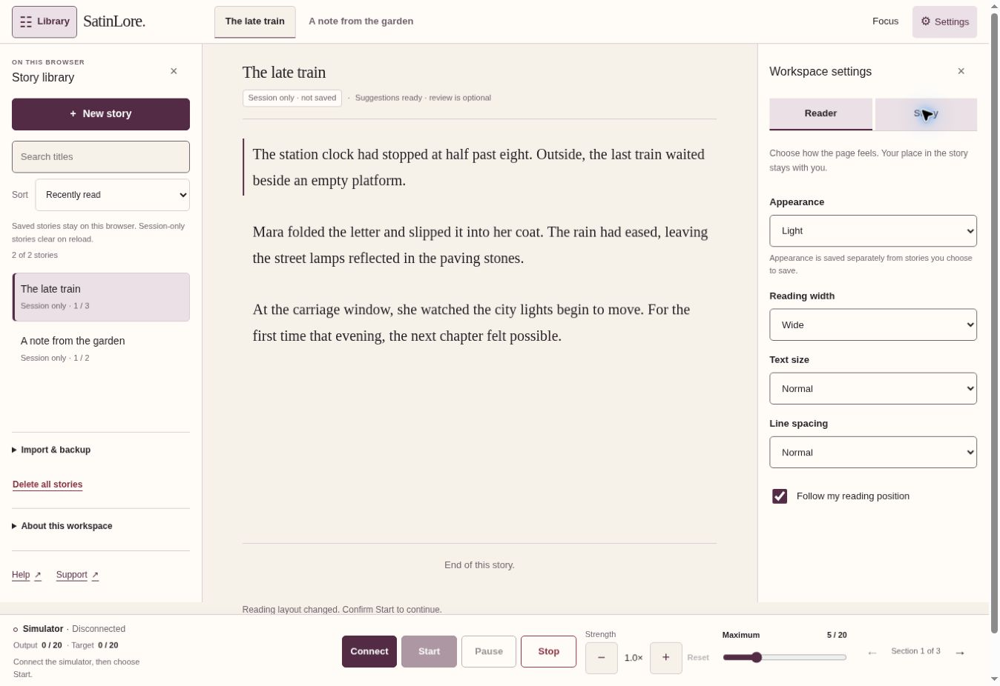

# SatinLore

A private browser reader that turns a person's chosen story into changing controls for a compatible Lovense toy. The app has hardware-free simulators, verified-email accounts, explicitly saved toy presets and a guided calibration-to-reading flow. Physical-device qualification remains separate from software implementation.

**For 3 November testing:** start with the [founder and tester session runbook](docs/beta-session-2026-11-03.md). It covers the remaining Cloudflare hostname/allowlist steps, account creation, the simulator rehearsal, live checks, personal-range permission, controlled stories and the private recording admin.

## Current experience

The NovelAI-inspired reader retains Satin Editorial, Midnight Ink and System appearance, a collapsible library, a continuous reading canvas and a right settings sidebar. Type/paste, upload and supported AO3 link import remain separate choices. Story analysis stays local and experimental; review is optional, and ordinary maximum adjustments do not open an interrupting popup.

After the existing Cloudflare email one-time PIN login, a reader explicitly confirms 18+ and creates a durable private app account. Named account-wide and story-specific presets retain per-movement minimum, background, preferred, maximum, recovery, rhythm and gain, plus selected active movements and master maximum. Applying them always pauses. **Story text is not cloud-synced:** it remains session-only until Save on this browser is chosen. Story-specific preset links use an opaque local story ID, so the same text newly imported on another device is not automatically recognized as the same story.

Setup offers Lush, Flexer, Nora, Domi, Velvo, Spinel, Dolce, Hush and Osci 3. Simulate and Connect my toy remain distinct. After explicit device selection and a checked gentle test, the guide explains the actual available movements, tunes one at a time, accepts optional ratings and offers qualified combinations. It then opens an original controlled story with an authored mapping, paused. The sidebar re-exposes movement controls, Explore the controls, per-channel tuning, Continuous background, Hold, Ease off, Follow story and saved presets.

Live control uses an isolated Lovense Remote bridge. The documented Standard Socket adapter can expose Oscillate and qualified combined actions; its narrower Standard JS fallback does not invent these capabilities. Heating and undocumented independent vibration motors are not implemented. All nonzero requests remain finite at two seconds. Initial gentle checks and unqualified actions are capped at 5/20. After checking a movement's response and targeted Stop, an explicit Enable personal range choice may permit up to 20/20 for that connection. It does not raise the chosen maximum or start output. Presets cannot grant permission; hide, expiry, disconnect and device changes reset it. Lower limits, manual zero and Stop remain authoritative.

The same private reader is packaged for app.satinlore.com and beta.satinlore.com. Only the exact beta host offers an explicit recording choice. Its structured control timeline captures allowed steps, settings changes, requested/simulated channel output, optional ratings, normalized navigation and fixed controlled-story identifiers. It does not capture DOM/screen video, story text/title, typed preset names, private URLs or pairing/credential material. Founder-only beta.satinlore.com/admin provides the timeline, channel graphs and review controls. Each recording is bounded to one hour, 20,000 events and 4 MiB; retained data expires after 30 days within a 128 MiB global budget. Recording controls are independent of device Stop.

The marketing website, CRM, SES and questionnaire bridge remain separate. The local Python invitation/device-check service also remains separate and retains its discrete low-level contract. Generated stories, billing, other toy brands, multiple physical toys and cloud story storage remain outside this iteration. No physical toy or full Lovense Remote feature parity is claimed from simulator results.

## Quick start

Install Python 3.12+, Git and VS Code; Node.js 24 for JavaScript checks. The simulator needs no hardware or credentials.

```sh
git clone https://github.com/adharasi/SatinLore.git
cd SatinLore
code .
```

Windows, in the VS Code terminal:

```powershell
py bootstrap.py
py run.py
```

macOS/Linux:

```sh
python3 bootstrap.py
python3 run.py
```

Open <http://127.0.0.1:8000>; Ctrl+C stops the server. Bootstrap installs dependencies into `.venv` using internet access. Select that VS Code interpreter with **Python: Select Interpreter**. Keep the exact configured origin: `localhost` and `127.0.0.1` are not interchangeable for authenticated requests.

For hardware work, follow [the dedicated setup](docs/hardware-check.md). `.env.example` documents process variables; the application does not automatically load `.env` files.

## Private hosted workspace

The private `app.satinlore.com` deployment uses the same reader and local story processing behind Cloudflare Access. The 1 November deployment and signed-in checks are recorded in the roadmap; each later release needs its own acceptance evidence. Its Worker validates a dedicated Access application's signed token before serving **every** reader asset. Missing configuration fails closed; direct Worker and preview hostnames are disabled. Access expiry or failed revalidation pauses playback, tears down a live connection, blocks Start and leaves the current text readable.

The reader explains why Start is unavailable, provides a nearby sign-in retry and supports repeated Start/Stop/reconnect without restoring an armed session. A synchronous access-check failure no longer leaves retries stuck.

This is a private **software beta** with hardware-free simulation, explicit account/preset persistence and a configured Lovense route. It does not claim qualified physical-device playback, a validated intensity algorithm or cloud story storage. The Python invitation/device-check backend stays local and is excluded from the hosted build. The one-time browser setup connects this GitHub repository to Cloudflare for automatic deployment on future pushes. Access settings remain in the Cloudflare dashboard and survive those deployments. See [the Cloudflare deployment runbook](deploy/cloudflare/README.md) for the exact setup, checks and rollback; source publication alone does not establish a live, protected deployment.

Useful hosted pages: `/help` for controls/privacy/build information, `/support` for private feedback and feedback data, and `/simulator-lab` for the founder's repeatable failure scenarios. Open these from the global gear menu; they open separately so session-only reader text remains in its original tab. Deliberate AO3 link import uses the authenticated `/api/story-import` service, temporarily fetching/extracting the requested public source without server retention or forwarding browser credentials; local drafts/uploads/saved stories are not automatically uploaded.



## Run checks

Install the pinned JavaScript dependencies once with `npm ci --ignore-scripts` before running the common checks. These include the private Worker's token-verification tests; the browser reader itself remains build-free.

```powershell
# Windows
py scripts/check.py
```

```sh
# macOS/Linux
python3 scripts/check.py
```

Use the [QA checklist](docs/qa.md) for browser and physical-device evidence. Fake SDK tests do not certify real hardware.

Optional browser integration checks use Playwright and a fake vendor SDK. See the QA checklist for installation; `scripts/check.py` remains the offline unit/syntax check command.

## Repository map

| Path | Purpose |
| --- | --- |
| `app/main.py`, `app/api/` | HTTP assembly, invitations, session identity, logout and vendor-token issuance |
| `app/core/` | Local-only configuration and mode validation |
| `app/services/`, `app/db/` | Server-side vendor exchange and SQLite invitation/session records |
| `app/static/appearance.js`, `theme.css`, `reader.css` | Theme preference, approved semantic colours and responsive reader layout |
| `app/static/reader/` | Local/direct and supported-link import, folders/storage, background analysis, optional corrections, position, guided setup and simulator visualisation |
| `app/static/devices/` | Nine-model profiles/simulators, SDK/bridge transport and reader device control |
| `app/static/device-check.*`, `device-bridge.*` | Separate hardware check and sandboxed vendor SDK bridge |
| `app/static/playback/` | Synchronous simulation and asynchronous targeted playback, cadence, ceiling and interruption control |
| `scripts/create_invite.py` | Local one-use invitation issuance |
| `tests/`, `scripts/check.py` | Automated checks and their common entry point |
| `docs/`, `deploy/` | Scope, roadmap, QA, setup and deployment planning |
| `AGENTS.md`, `app/static/AGENTS.md` | Repository and browser instructions for Codex |

## Work with Codex

Install the official OpenAI Codex VS Code extension, sign in and open this repository root. See [the Codex workflow](docs/codex.md).

Next: complete the account, preset, guided calibration, combined-control and recording acceptance checks with real readers, then evaluate the intensity algorithm (F5) against suitable material. Cloud story storage and custom model/paid entitlements remain future milestones. The F3 harness and hosted feedback/support/data journeys are implemented; invited-beta access requires explicit tester configuration in both Access layers. The bounded live route is for controlled qualification; wider hardware support requires observed per-model results. See the [software-first roadmap](docs/beta-roadmap.md); keep mocked, browser and physical evidence separate. Supply hosted device credentials through private runtime configuration (or local process variables for the separate Python service), never chat or committed files.
