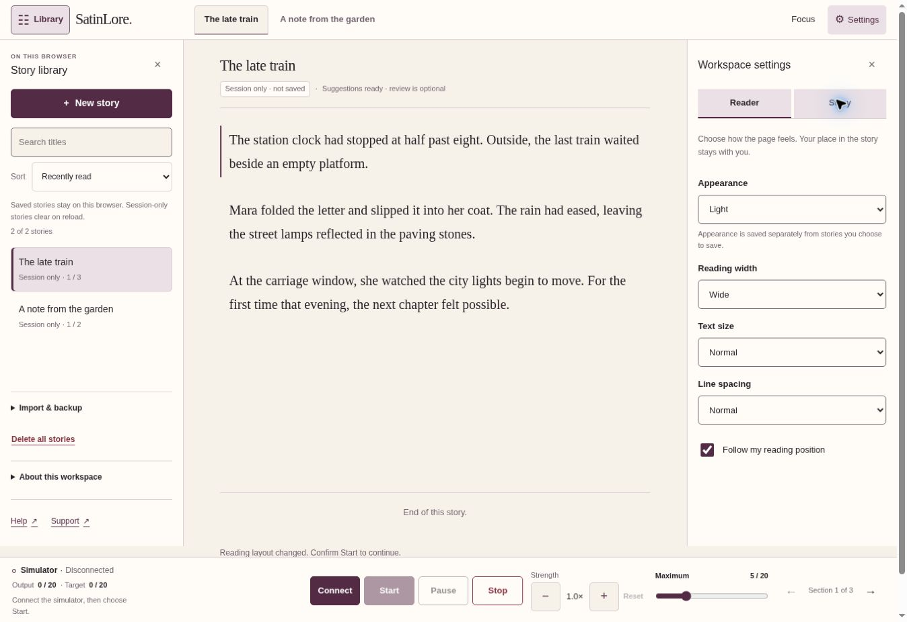

# SatinLore

A browser reader that changes a compatible toy's rhythm and strength as someone reads their own story. Readers can sign in with a verified email and password, save stories to their account, and save settings for their toy. Physical-device qualification remains separate from software implementation.

**For 3 November testing:** start with the [founder and tester session runbook](docs/beta-session-2026-11-03.md). It covers the remaining Cloudflare hostname/allowlist steps, account creation, the simulator rehearsal, live checks, personal-range permission, controlled stories and the private recording admin.

**Public reader rollout:** follow the [launch runbook](docs/launch-rollout.md) for email sign-in, private tester access and paid plans. See the [onboarding walkthrough and UX review](docs/public-reader-ux-review.md) for follow-up usability improvements.

## Current experience

The NovelAI-inspired reader opens in Midnight Ink for new visitors, with Satin Editorial and System appearance choices, a collapsible library, a continuous reading canvas and a right settings sidebar. **Add a story** brings together writing or pasting, TXT or AO3 HTML upload, and public AO3 link import. Analysis suggests intensity, rhythm and movement by section. When it finds reliable movement cues, it lists matching toy models above the story. Review is optional. The dock changes the current section target one level at a time, and the maximum slider applies directly.

The reader follows steady scrolling and suspends playback during large jumps until the new section settles. **Finish reading** stops playback. Replay returns to the first section and asks for confirmation. The compact mobile dock keeps the current level and Stop visible. Optional review shows up to ten sections at a time, and a shortcut opens feedback for a played section.

**Loom** is the default story model. The optional **Nocturne** private beta adds GPT-6 Luna classification of up to 16 locally derived scene cues on explicit request. The cue-only action excludes story text and device settings. Separately enabled contextual review sends bounded nearby excerpts to OpenAI, including eligible paragraphs Loom missed. It distinguishes events happening in the scene from imagined, reported and historical events. The simulator preserves contrast for supported current cues within the reader's calibration. Contextual consent and annotations stay in memory for the current story session. Loom covers excluded sections and service failures. [Defaults, privacy, cost and evaluation](docs/nocturne-context-phase.md) · [Enable and verify Nocturne](deploy/cloudflare/README.md#enable-nocturne-for-the-private-beta)

Public readers use a dedicated `/signup` page to create an account with an email and password, confirm 18+, verify their address and then sign in. Password reset requires a code sent to the verified inbox. The private beta still uses its existing Cloudflare Access login. Named account-wide and story-specific presets retain per-movement minimum, background, preferred, maximum, recovery, rhythm and gain, plus selected active movements and master maximum. Applying them always pauses. New stories are session-only. **Save on this browser** keeps them local. **Save to my account** sends the selected story and reading details to the signed-in account library for access from another browser. Browser shelves remain local. Public account reading settings sync separately from the story.

Fresh reading preferences use Continuous background, Follow scene rhythm and Steady hold for Nocturne peaks, under the existing limits. Explicitly saved preferences are preserved. The public reader asks four optional questions after sign-in about quiet passages, edging, maximum intensity and rhythm. In **Settings → Device preferences**, choose **Preview onboarding** to rehearse the questions with fresh defaults, or **Edit device preferences** to apply changes. Nocturne uses those choices to shape quiet passages, build-ups and climaxes in the simulator. **Reading controls → Advanced → Nocturne patterns** lets readers choose build-up and climax patterns independently. Saving preferences keeps playback paused and does not grant a higher physical range.

Setup offers 33 [Lovense model and family profiles](docs/lovense-compatibility.md). The main hosted reader uses three steps: pair, run a quick check and open Advanced controls. Choose the device explicitly, then check its available movements on one screen. Movements are selected together where the connection supports them. The detailed calibration controls remain available when wanted, and the beta host retains its existing test workflow.

Live control uses an isolated Lovense Remote bridge. The documented Standard Socket adapter can expose Oscillate and qualified combined actions; its narrower Standard JS fallback does not invent these capabilities. Heating and undocumented independent vibration motors are not implemented. All nonzero requests remain finite at two seconds. Initial gentle checks and unqualified actions are capped at 5/20. After checking a movement's response and targeted Stop, an explicit Enable personal range choice may permit up to 20/20 for that connection. It does not raise the chosen maximum or start output. Presets cannot grant permission; hide, expiry, disconnect and device changes reset it. Lower limits, manual zero and Stop remain authoritative.

The same private reader is packaged for app.satinlore.com and beta.satinlore.com. Only the exact beta host offers an explicit recording choice. Its structured control timeline captures allowed steps, settings changes, requested/simulated channel output, optional ratings, normalized navigation and fixed controlled-story identifiers. It does not capture DOM/screen video, story text/title, typed preset names, private URLs or pairing/credential material. Founder-only beta.satinlore.com/admin provides the timeline, channel graphs and review controls. Each recording is bounded to one hour, 20,000 events and 4 MiB; retained data expires after 30 days within a 128 MiB global budget. Recording controls are independent of device Stop.

The marketing website, CRM, SES and questionnaire bridge have separate deployments. The Python invitation and device check run locally. The launch branch includes hosted billing for subscriptions and AI credit top-ups, subject to merchant approval and rollout. Generation and simultaneous control of multiple physical toys are outside this release.

## Quick start

Install Python 3.12+, Git and VS Code; Node.js 24 for JavaScript checks. The simulator needs no hardware or credentials.

```sh
git clone https://github.com/adharasi/SatinLore.git
cd SatinLore
code .
```

Windows, in the VS Code terminal:

```powershell
py bootstrap.py
py run.py
```

macOS/Linux:

```sh
python3 bootstrap.py
python3 run.py
```

Open <http://127.0.0.1:8000>; Ctrl+C stops the server. Bootstrap installs dependencies into `.venv` using internet access. Select that VS Code interpreter with **Python: Select Interpreter**. Keep the exact configured origin: `localhost` and `127.0.0.1` are not interchangeable for authenticated requests.

For hardware work, follow [the dedicated setup](docs/hardware-check.md). [`.env.example`](.env.example) is the copyable template for local settings. The Python app reads process variables. For live Luna CLI commands, see [local OpenAI credentials](docs/nocturne-vscode-handoff.md#local-openai-credentials).

## Hosted reader and private testing

The `app.satinlore.com` reader processes stories locally by default. With public email sign-in enabled, guests can open their own text and read. A verified account is required for device pairing, Nocturne, link imports, saved presets and feedback. Direct Worker and preview hostnames are disabled. Session expiry or failed revalidation pauses playback and disconnects the toy, and the current text stays readable.

The reader explains why Start is unavailable, provides a nearby sign-in retry and supports repeated Start/Stop/reconnect without restoring an armed session. A synchronous access-check failure no longer leaves retries stuck.

The [private beta launch preview](docs/beta-preview.md) uses a separate Worker and dedicated Cloudflare Access audience at `app.satinlore.com/beta/`. It includes beta accounts, Stripe sandbox billing, usage and the approved tester simulator. The separate `beta.satinlore.com` recording programme and Alpha study keep their own sign-in. The Python invitation/device-check backend stays local. See [the Cloudflare deployment runbook](deploy/cloudflare/README.md) for setup, checks and rollback. Physical playback and model performance are qualified separately.

The reader links to `/help` for controls and privacy and `/support` for feedback. The founder inbox is on `beta.satinlore.com/feedback-admin`. The beta lab for repeatable failure scenarios is at `/beta/simulator-lab` on the app hostname. An AO3 link import uses the authenticated `/api/story-import` service to fetch the selected public source. The service neither retains the source nor forwards browser credentials.



## Run checks

Install the pinned JavaScript dependencies once with `npm ci --ignore-scripts` before running the common checks. These include the private Worker's token-verification tests; the browser reader itself remains build-free.

```powershell
# Windows
py scripts/check.py
```

```sh
# macOS/Linux
python3 scripts/check.py
```

Use the [QA checklist](docs/qa.md) for browser and physical-device evidence. Fake SDK tests do not certify real hardware.

Optional browser integration checks use Playwright and a fake vendor SDK. See the QA checklist for installation; `scripts/check.py` remains the offline unit/syntax check command.

## Repository map

| Path | Purpose |
| --- | --- |
| `app/main.py`, `app/api/` | HTTP assembly, invitations, session identity, logout and vendor-token issuance |
| `app/core/` | Local-only configuration and mode validation |
| `app/services/`, `app/db/` | Server-side vendor exchange and SQLite invitation/session records |
| `app/static/appearance.js`, `theme.css`, `reader.css` | Theme preference, approved semantic colours and responsive reader layout |
| `app/static/reader/` | Local/direct and supported-link import, folders/storage, background analysis, optional corrections, position, guided setup and simulator visualisation |
| `app/static/devices/` | Lovense profiles and simulators, SDK/bridge transport and reader device control |
| `app/static/device-check.*`, `device-bridge.*` | Separate hardware check and sandboxed vendor SDK bridge |
| `app/static/playback/` | Synchronous simulation and asynchronous targeted playback, cadence, ceiling and interruption control |
| `scripts/create_invite.py` | Local one-use invitation issuance |
| `tests/`, `scripts/check.py` | Automated checks and their common entry point |
| `docs/`, `deploy/` | Scope, roadmap, QA, setup and deployment planning |
| `AGENTS.md`, `app/static/AGENTS.md` | Repository and browser instructions for Codex |

## Work with Codex

Install the official OpenAI Codex VS Code extension, sign in and open this repository root. See [the Codex workflow](docs/codex.md).

For Luna annotation and discrepancy analysis, open the [Nocturne VS Code handoff](docs/nocturne-vscode-handoff.md). It links the approved protocol, frozen 181-target labels, the 41-work offline compiler benchmark, the exact private corpus download and the copy-ready agent prompt.

The next milestone is controlled-release qualification, including blind story labelling, replay, live contextual coverage and reader and device checks. Invited-beta access requires explicit tester configuration in both Access layers. Wider hardware support requires observed per-model results. Supply hosted device credentials through private runtime configuration or local process variables for the separate Python service. [Release acceptance](docs/release-acceptance.md) · [Software-first roadmap](docs/beta-roadmap.md)
